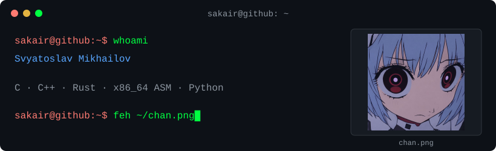

<div align="center">
  
</div>

```console
sakair@github:~$ git log --oneline --author=sakair staging-testing
aa5a27bcd811 staging: sm750fb: rename p_PLL to pll in sm750_format_pll_reg()
```


```console
sakair@github:~$ cat kernel.log
[2026-11-20] staging: sm750fb: rename p_PLL to pll
[2026-11-20] merged into staging-testing (maintainer: Greg Kroah-Hartman)
```

→ 
[lore.kernel.org](https://lore.kernel.org/r/20261111074816.27647-1-sakairlinux@gmail.com) · [staging-testing](https://git.kernel.org/pub/scm/linux/kernel/git/gregkh/staging.git/commit/?h=staging-testing&id=aa5a27bcd8118ffdd4c5bbf3a2068135571b257d) — my first Linux kernel patch, at 17.

```console
sakair@github:~$ ls ~/projects
```

- [`Jarvis/`](https://github.com/Saka1r/Jarvis) — fully offline voice assistant: Vosk STT → llama.cpp → XTTS v2. Plugin system, zero cloud.
- [`chip8-rs/`](https://github.com/Saka1r/School_project_cpu) — CHIP-8 emulator in Rust, built to understand how CPUs work.
- [`brainfuck/`](https://github.com/Saka1r/brainfuck) — interpreter in hand-written x86_64 NASM. No libc, pure Linux syscalls.
- [`fu/`](https://github.com/Saka1r/fu) — VCS internals from scratch in C/C++.
- [`nuta/`](https://github.com/Saka1r/nuta) — Terminal code editor. 

```console
sakair@github:~$ cat now.txt
```

- next patches to open-source
- building `nuta` and `Jarvis`

```console
sakair@github:~$ cat contact.txt
```

[portfolio](https://saka1r.github.io/portfolio/) · [email](mailto:sakairlinux@gmail.com) · [telegram](https://t.me/sakairCode)

